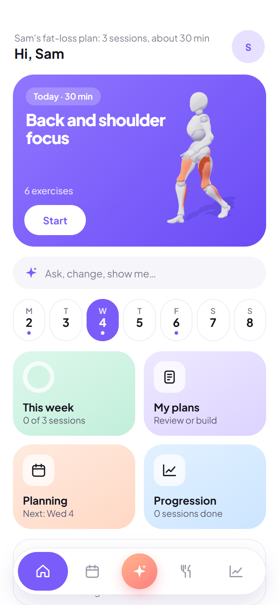
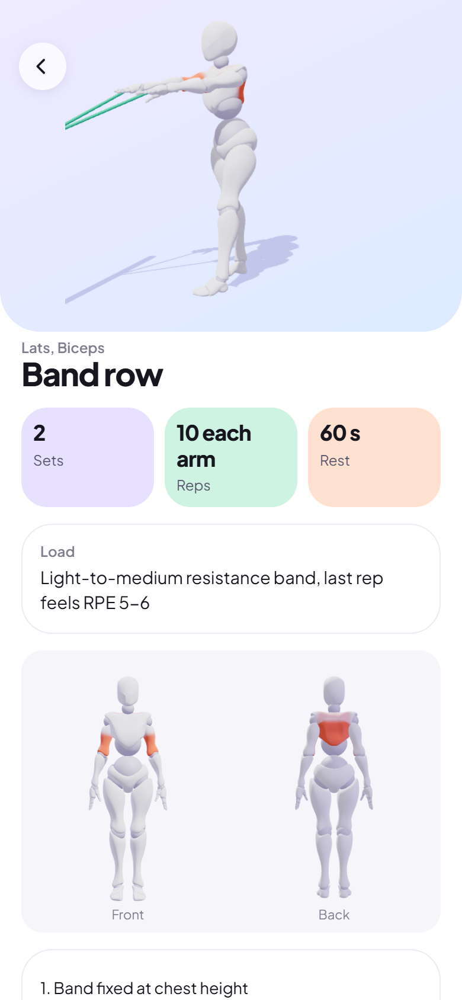
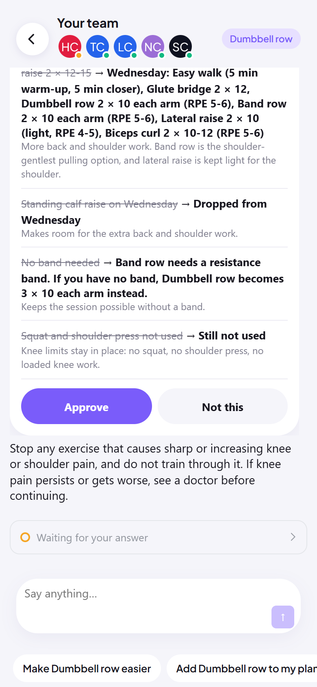
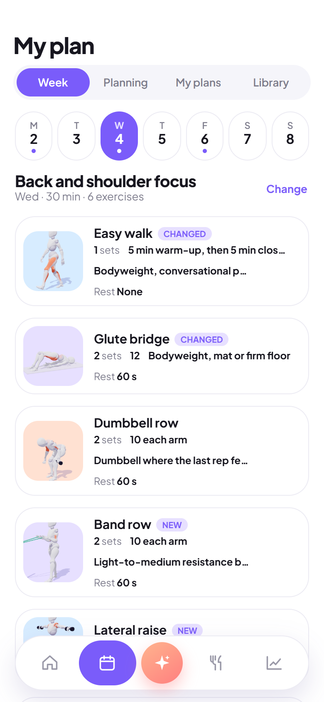
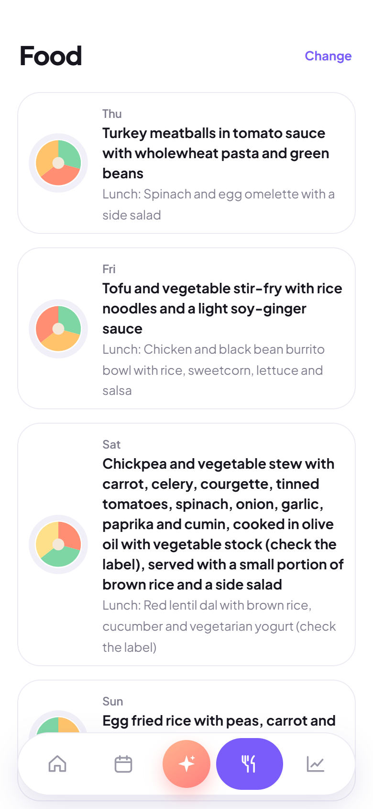
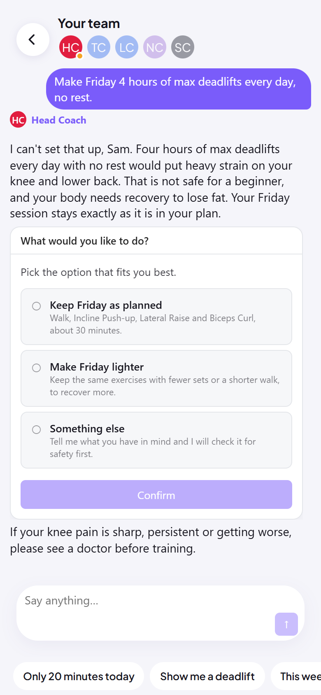

# Momentum

**A team of AI coaches builds your training plan with you, in the chat.**

Momentum is a showcase of a VibeApp: an application whose screens are built around a conversation with a team of AI agents. You tell the coaches about your body, your time and your gear. They answer with widgets right in the chat, such as animated 3D exercises, a week of sessions, a meal plan and choice cards, and they build a first plan for you. When something changes ("the machine is taken", "my shoulder hurts"), you say it, and the team adapts the plan.

Built with the [Agentivity React SDK](https://github.com/agentivity-labs/agentivity_sdk_react). The coaches run in an [Agentivity](https://github.com/agentivity-labs/agentivity) workspace.

> Momentum is a demo, not a product. It is not a coaching or medical service, and it cannot be used as is to sell one.

<table>
  <tr>
    <td align="center"><br><sub>Today's session, ready to start</sub></td>
    <td align="center"><br><sub>Every exercise drawn in 3D</sub></td>
    <td align="center"><br><sub>Each change shown before it applies</sub></td>
  </tr>
  <tr>
    <td align="center"><br><sub>The plan, with what changed</sub></td>
    <td align="center"><br><sub>A week of simple meals</sub></td>
    <td align="center"><br><sub>An unsafe request, declined</sub></td>
  </tr>
</table>

## What it shows

- **Widgets in the chat.** The coaches name exercises from a catalogue, and the app draws them in 3D. Plans, meals, progress and choices also come as widgets, not as walls of text.
- **A conversation instead of forms.** Questions, changes and "the machine is taken" all go through the team.
- **Classic screens where they work better.** Home, the plan, the session runner, food and progress are plain screens that read what the team built. Each one opens the chat with its own context.
- **You approve every change.** A change comes as a card that shows what was there and what replaces it. The plan is updated only after you approve.
- **Agents stay inside a frame.** The coaches pick exercises only from the catalogue of 32. An exercise outside it cannot appear.

## The team

The coaches come from the **Momentum Coaches** Template:

| Coach | Role |
| --- | --- |
| Head Coach | The only one who talks to you. Asks what it needs in a few short questions and hands the work to the others. |
| Training Coach | Picks the exercises, only from the catalogue, for your goal, level, place and equipment. |
| Load Coach | Sets the sets, reps, weight and rest for each exercise. |
| Nutrition Coach | Builds simple food rules and example meals around your goal, habits and allergies. |
| Safety Coach | Checks the whole plan against injuries, pain, age and allergies before it reaches you. |

## Run it

### 1. Get the coach team

You need an Agentivity workspace with a connection to an AI model. Import the [Momentum Coaches Template](https://synergi.agentivity.io/templates/momentum-coaches) into it (**Templates > Import from file**). It brings the five coaches and the catalogue of 32 exercises. Note the id of the imported team.

### 2. Get the code

The SDK is linked from a sibling folder, so clone both repositories side by side:

```bash
git clone https://github.com/agentivity-labs/agentivity_sdk_react.git
```

```bash
git clone https://github.com/agentivity-labs/agentivity_sdk_showcase_coach.git
```

### 3. Configure

Copy `.env.example` to `.env.local` and fill it in:

```
VITE_AGENTIVITY_BASE_URL=<your workspace URL>
VITE_COACH_TEAM_ID=<the id of the imported team>
VITE_AGENTIVITY_API_KEY=<a web page key (agp_...), only if your workspace asks to sign in>
```

Use a **web page key** (`agp_…`), which is limited to the sites you list. Never put a secret key (`agv_…`) in a web app: anything in `.env.local` ends up in the browser.

### 4. Start

```bash
npm install
```

```bash
npm run dev
```

## How the 3D figure works

`src/figure/exercises.json` holds each exercise as a few key positions, plus the muscles at work. `src/figure/engine.js` turns them into a 3D body by applying fixed rules: a knee or an elbow bends one way only, and supports stay on their surface. In development, `checks` in the same file measures each exercise against anatomy, balance and contact rules.

The 3D character (Xbot, from the three.js examples) is loaded at run time and is not copied into this repository.

## Project layout

```
src/
  App.tsx            Provider and screens
  screens/           Home, plan, session, food, progress, and the coach chat
  widgets/           The widgets the coaches answer with (plan week, food week, change card, choices…)
  figure/            The 3D exercise figure and its catalogue of poses
  plan.ts            The plan the team built, shared by the screens
```

## Licence

[MIT](LICENSE)
